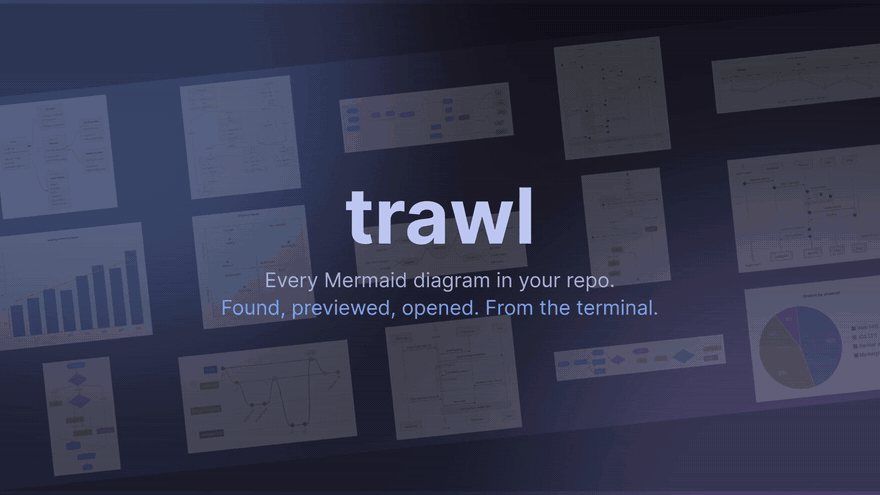

# trawl

Find every Mermaid diagram in a set of folders, preview it in the terminal, and open it as a crisp PNG in
[feh](https://feh.finalrewind.org/) (or as an SVG in your browser).



- Scans `.md` files for ` ```mermaid ` / `~~~mermaid` blocks and whole `.mmd` files, labelling each diagram with the
  nearest markdown heading.
- Renders without a browser or Chromium: [pele](https://github.com/obsidianmd/pele) draws the SVG,
  [resvg](https://github.com/linebender/resvg) rasterizes it with a bundled Inter font, so PNGs look the same on every
  machine.
- Previews the real rendered diagram inside the picker in terminals that support inline images (Ghostty, kitty,
  WezTerm). Elsewhere (Alacritty, tmux, ...) it falls back to colored box-drawing art
  ([beautiful-mermaid](https://github.com/lukilabs/beautiful-mermaid): flowchart, sequence, state, class, ER and XY
  charts; other types show their source). `TRAWL_IMAGES=0` or `=1` overrides the detection.
- `trawl check` doubles as a Mermaid linter for CI.

## Install

Needs [Bun](https://bun.sh) (`curl -fsSL https://bun.sh/install | bash`); fzf and feh are optional but recommended.

```sh
git clone https://github.com/snowu/trawl && cd trawl && ./install.sh
```

The installer, re-runnable at any time:

1. builds the binary into `~/.local/bin/trawl`,
2. asks which folders trawl scans (`trawl roots pick`: fzf over `~`, or type any path),
3. adds a shell keybind to `~/.zshrc` / `~/.bashrc`: **alt+m** (letter configurable) opens the picker on the repo
   you're in,
4. installs a [Claude Code](https://claude.com/claude-code) skill (`~/.claude/skills/trawl`) so agents run
   `trawl check` on diagrams they write and `trawl open` to show them to you. With Figma's MCP connected
   (`claude plugin install figma@claude-plugins-official`, then `/mcp` → figma → Authenticate) they can also publish
   diagrams as editable FigJam boards and pull boards back into your markdown as Mermaid; just ask.

`./install.sh --yes` takes every default without asking; `--no-keybind` and `--no-skill` skip those steps.
The keybind works in any terminal and inside tmux/herdr, wherever you are at a zsh or bash prompt (on macOS, set the
terminal's Option key to send Esc/Meta).

Prebuilt binaries for linux/macOS x64/arm64 are also attached to [Releases](../../releases) if you only want the CLI.

### Uninstall

```sh
./uninstall.sh          # lists what it found, asks, then removes it; --yes to skip the question
```

It removes the binary, `~/.config/trawl` (config + generated keybind files), `~/.cache/trawl`,
`~/.claude/skills/trawl` and the `# >>> trawl >>>` block in `~/.zshrc` / `~/.bashrc`. Nothing else in your rc files
is touched.

### Clean install

From your clone, remove any previous install and install again:

```sh
./uninstall.sh --yes && ./install.sh
exec "$SHELL"   # reload your rc so the keybind is live
```

Then check it works (`examples/` in the repo has mock diagrams of every common type, plus one broken one):

```sh
trawl check examples   # broken/typo.md:11 reported, 15/16 diagrams OK, exit 1
trawl examples         # picker over the examples
trawl --all            # picker over your configured folders
```

## Usage

```sh
trawl                      # picker over the git repo you're in (the alt+m keybind); from ~, your configured folders
trawl --all                # picker over all your configured folders
trawl docs ../other-repo   # picker over these folders/files
trawl -b docs              # open in the browser instead of feh
trawl open docs/a.md:40    # open the diagram at line 40 straight away (no picker)
trawl list docs            # path:line  type  title, one per line (pipe-friendly)
trawl check docs           # syntax errors with file:line, exit 1 if any
trawl render docs -o out   # write every diagram to out/ as PNG (--format svg for SVG)
```

Configured folders:

```sh
trawl roots                # list them
trawl roots pick           # choose with fzf (anything under ~, tab for several, or type a path)
trawl roots add ~/notes    # add / remove without fzf
trawl roots remove ~/notes
```

They live in `~/.config/trawl/config.json` as `{ "roots": ["~/code", "~/notes"] }` if you prefer editing it.

Picker keys:

| Key | Action |
|---|---|
| type | filter: every word must match the title, path or diagram type |
| ↑/↓, ctrl-p/ctrl-n, PgUp/PgDn | move |
| tab | mark / unmark (enter then opens all marked) |
| enter | open in feh (falls back to the browser when feh isn't installed) |
| ctrl-o | open in the browser |
| ctrl-f | choose subfolders of what's being scanned (fzf), then reopen on just those |
| ctrl-a | reopen on all your configured folders |
| ←/→ | previous / next folder |
| shift ←/→ | pan a wide text preview |
| mouse | click a row to select it, wheel over the list to move; over an image: wheel zooms, drag pans, right-click resets |
| ctrl-t | toggle preview between diagram and source |
| ctrl-y | copy the mermaid source (marked: all of them, as fenced blocks) |
| esc | clear the filter, or quit |

The list is grouped by folder. Broken diagrams are marked ✗; selecting one shows the syntax error with its line
instead of a preview.

Rendered files are cached in `$XDG_CACHE_HOME/trawl` (default `~/.cache/trawl`), keyed by diagram source.

Directories are walked recursively, skipping dot-directories (`.git`, `.venv`, ...) and `node_modules`, `dist`,
`build`, `vendor`, `__pycache__`.

## Try it

`examples/` has mock diagrams of every common type (flowchart, sequence, class, ER, state, gantt, pie, timeline,
mindmap, gitGraph, journey, XY and quadrant charts) in nested folders, plus one deliberately broken diagram:

```sh
trawl examples             # picker (ctrl+f to narrow to examples/ subfolders)
trawl check examples       # reports examples/broken/typo.md:11
```

## Development

```sh
bun install
bun test
bun run typecheck
bun run build              # single binary in bin/trawl
bun src/cli.ts docs        # run from source
```

Releases: push a `v*` tag and CI attaches binaries for linux/macOS x64/arm64.

`stubs/react-devtools-core` is a no-op stand-in for an optional Ink import that otherwise breaks
`bun build --compile`.

## License

MIT. Bundled Inter font: SIL Open Font License 1.1 (`fonts/OFL.txt`).
