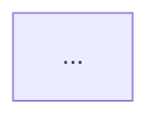

# trawl

Search every markdown doc on your machine, find every Mermaid diagram in them, preview diagrams in the terminal and
open them as crisp PNGs in [feh](https://feh.finalrewind.org/) (or as SVGs in your browser). Agents get the same
through an MCP server: search and read your docs, check, render (as images they can look at) and edit diagrams.


- Scans `.md` files for ` ```mermaid ` / `~~~mermaid` blocks and whole `.mmd` files, labelling each diagram with the
  nearest markdown heading.
- Renders without a browser or Chromium: [pele](https://github.com/obsidianmd/pele) draws the SVG,
  [resvg](https://github.com/linebender/resvg) rasterizes it with a bundled Inter font, so PNGs look the same on every
  machine.
- Previews the real rendered diagram inside the picker in terminals that support inline images (Ghostty, kitty,
  WezTerm). Elsewhere (Alacritty, tmux, ...) it falls back to colored box-drawing art
  ([beautiful-mermaid](https://github.com/lukilabs/beautiful-mermaid): flowchart, sequence, state, class, ER and XY
  charts; other types show their source). `TRAWL_IMAGES=0` or `=1` overrides the detection.
- `trawl check` doubles as a Mermaid linter for CI.
- `trawl find` (alt+k) searches every doc and section in your folders and the repo you're in: live results in fzf,
  the matching section as preview, enter opens it in `$EDITOR` at that line. A full-text index (SQLite) is updated
  incrementally, so searching thousands of notes stays instant.
- `trawl mcp` is an MCP server for Claude Code, Claude Desktop, Cursor or any MCP client (see [MCP](#mcp)).

## Install

Needs [Bun](https://bun.sh) (`curl -fsSL https://bun.sh/install | bash`); fzf and feh are optional but recommended.

```sh
git clone https://github.com/snowu/trawl && cd trawl && ./install.sh
```

The installer, re-runnable at any time:

1. builds the binary into `~/.local/bin/trawl`,
2. asks which folders trawl scans (`trawl roots pick`: fzf over `~`, or type any path),
3. adds a shell keybind to `~/.zshrc` / `~/.bashrc`: **alt+m** (letter configurable) opens the picker on the repo
   you're in,
4. adds **alt+k**, which searches your docs (`trawl find`),
5. installs a [Claude Code](https://claude.com/claude-code) skill (`~/.claude/skills/trawl`) so agents run
   `trawl check` on diagrams they write and `trawl open` to show them to you. With Figma's MCP connected
   (`claude plugin install figma@claude-plugins-official`, then `/mcp` → figma → Authenticate) they can also publish
   diagrams as editable FigJam boards and pull boards back into your markdown as Mermaid; just ask.
6. registers `trawl mcp` as a user-scoped MCP server in Claude Code (`claude mcp add -s user trawl -- trawl mcp`).

`./install.sh --yes` takes every default without asking; `--no-keybind`, `--no-skill` and `--no-mcp` skip those
steps.
The keybind works in any terminal and inside tmux/herdr, wherever you are at a zsh or bash prompt (on macOS, set the
terminal's Option key to send Esc/Meta).

Prebuilt binaries for linux/macOS x64/arm64 are also attached to [Releases](../../releases) if you only want the CLI.

### Uninstall

```sh
./uninstall.sh          # lists what it found, asks, then removes it; --yes to skip the question
```

It removes the binary, `~/.config/trawl` (config + generated keybind files), `~/.cache/trawl` (renders and the
search index), `~/.claude/skills/trawl`, the `trawl` MCP server registration and the `# >>> trawl >>>` block in `~/.zshrc` / `~/.bashrc`. Nothing else in your rc files
is touched.

### Clean install

From your clone, remove any previous install and install again:

```sh
./uninstall.sh --yes && ./install.sh
exec "$SHELL"   # reload your rc so the keybind is live
```

Then check it works (`examples/` in the repo has mock diagrams of every common type, plus one broken one):

```sh
trawl check examples   # broken/typo.md:11 reported, 15/16 diagrams OK, exit 1
trawl examples         # picker over the examples
trawl --all            # picker over your configured folders
```

## Usage

```sh
trawl                      # picker over the git repo you're in (the alt+m keybind); from ~, your configured folders
trawl --all                # picker over all your configured folders
trawl docs ../other-repo   # picker over these folders/files
trawl -b docs              # open in the browser instead of feh
trawl open docs/a.md:40    # open the diagram at line 40 straight away (no picker)
trawl list docs            # path:line  type  title, one per line (pipe-friendly)
trawl check docs           # syntax errors with file:line, exit 1 if any
trawl render docs -o out   # write every diagram to out/ as PNG (--format svg for SVG)

trawl find                 # search all your docs (fzf; alt+k)
trawl find refund policy   # same, starting from a query
trawl find --plain refund  # path:line  section › breadcrumb  snippet (scripts, agents)
trawl find -i ~/notes q    # only in this folder (repeatable)
trawl show a.md:40         # print the section at line 40 (or a.md#heading-slug, a.md#diagram-id)
trawl index                # update the index now and print what it holds (--rebuild to start over)
```

`find` searches your configured folders plus the repo you're in. Every word must match (prefixes and plurals
count: `refund` finds "refunds"); headings weigh more than body text. An empty query lists recently edited docs.
In the fzf view: enter opens the section in `$VISUAL`/`$EDITOR`, ctrl-o opens the diagrams in that section,
ctrl-y copies `path:line`.

### Diagram ids

Each diagram has an id that stays put while lines move around it, so agents, links and reviews can point at it as
`file.md#id`. By default it is the nearest heading as a slug (`## Order Lifecycle` → `order-lifecycle`, repeats get
`-2`, `-3`). Pin one that survives renaming the heading with either:

````md

````

or a `%% trawl:id checkout-flow` line inside the diagram (works in `.mmd` files too).

Configured folders:

```sh
trawl roots                # list them
trawl roots pick           # choose with fzf (anything under ~, tab for several, or type a path)
trawl roots add ~/notes    # add / remove without fzf
trawl roots remove ~/notes
```

They live in `~/.config/trawl/config.json` as `{ "roots": ["~/code", "~/notes"] }` if you prefer editing it.

Picker keys:

| Key | Action |
|---|---|
| type | filter: every word must match the title, path or diagram type |
| ↑/↓, ctrl-p/ctrl-n, PgUp/PgDn | move |
| tab | mark / unmark (enter then opens all marked) |
| enter | open in feh (falls back to the browser when feh isn't installed) |
| ctrl-o | open in the browser |
| ctrl-f | choose subfolders of what's being scanned (fzf), then reopen on just those |
| ctrl-a | reopen on all your configured folders |
| ←/→ | previous / next folder |
| shift ←/→ | pan a wide text preview |
| mouse | click a row to select it, wheel over the list to move; over an image: wheel zooms, drag pans, right-click resets |
| ctrl-t | toggle preview between diagram and source |
| ctrl-y | copy the mermaid source (marked: all of them, as fenced blocks) |
| esc | clear the filter, or quit |

The list is grouped by folder. Broken diagrams are marked ✗; selecting one shows the syntax error with its line
instead of a preview.

Rendered files are cached in `$XDG_CACHE_HOME/trawl` (default `~/.cache/trawl`), keyed by diagram source.

Directories are walked recursively, skipping dot-directories (`.git`, `.venv`, ...) and `node_modules`, `dist`,
`build`, `vendor`, `__pycache__`.

## MCP

`trawl mcp` speaks MCP on stdio. The installer registers it for Claude Code; for other clients add
`"trawl": { "command": "trawl", "args": ["mcp"] }` to their MCP config. Its scope is your configured folders plus
the repo it was started in.

| Tool | What it does |
|---|---|
| `search` | full-text search over docs and sections; empty query = recently edited docs |
| `read` | a section (`file:LINE`, `file#heading-slug`) or a whole file |
| `list_diagrams` | every diagram as `path#id`, type, title; optional word filter |
| `get_diagram` | one diagram's source, location and whether it parses |
| `check` | syntax-check raw source, one diagram, or every diagram under some folders |
| `render` | a diagram or raw source as a PNG image the agent can look at (or SVG text) |
| `update_diagram` | replace one diagram's source in place; refuses source that doesn't parse and files outside trawl's folders |

## Try it

`examples/` has mock diagrams of every common type (flowchart, sequence, class, ER, state, gantt, pie, timeline,
mindmap, gitGraph, journey, XY and quadrant charts) in nested folders, plus one deliberately broken diagram:

```sh
trawl examples             # picker (ctrl+f to narrow to examples/ subfolders)
trawl check examples       # reports examples/broken/typo.md:11
```

## Development

```sh
bun install
bun test
bun run typecheck
bun run build              # single binary in bin/trawl
bun src/cli.ts docs        # run from source
```

Releases: push a `v*` tag and CI attaches binaries for linux/macOS x64/arm64.

`stubs/react-devtools-core` is a no-op stand-in for an optional Ink import that otherwise breaks
`bun build --compile`.

## License

MIT. Bundled Inter font: SIL Open Font License 1.1 (`fonts/OFL.txt`).
